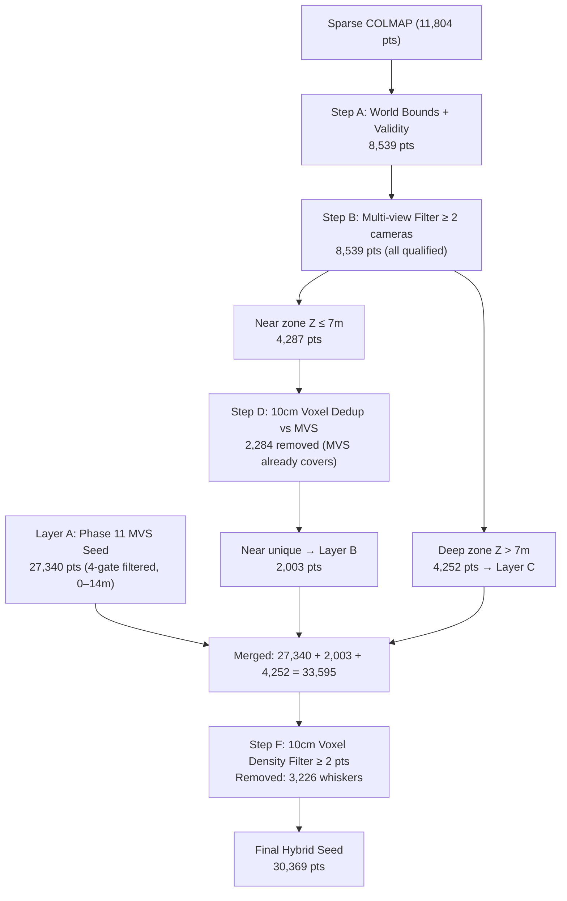

# NAMMA SPACE — PHASE 12: HYBRID MVS + SPARSE GAUSSIAN SEEDING EXPERIMENT

**Experiment ID:** `IMG_5449_phase12_hybrid_seeded`  
**Date:** October 29, 2026  
**Hardware:** Apple Silicon M4 · 16 GB Unified Memory · PyTorch `mps`  
**Frames:** 63 training | 8 held-out validation (unchanged from Phase 11)  
**Status:** ✅ Complete — evaluated, visualised, and documented

---

## 1. Objective

Test whether supplementing the Phase 11 MVS seed cloud with selected sparse COLMAP points can recover the deep-corridor coverage that was lost by the 7 m depth cutoff in Phase 11, while preserving the floor/centre-room structural gains, and without introducing new floaters.

---

## 2. Step 1 — Phase 11 Pre-inspection Findings

Before building the hybrid seed, the Phase 11 implementation was audited against every listed safeguard.

### 2.1 Coordinate Frame Verification

| Source | Frame | +Y direction | Z range (world) |
| :--- | :---: | :---: | :---: |
| `transforms.json` camera poses | COLMAP native | Down (toward floor) | −3.60 → 9.24 m |
| `dense_native_colmap.ply` (raw MVS) | COLMAP native | Down | −2.03 → 36.85 m |
| `initial_mvs_points.ply` (Phase 11 seed) | COLMAP native | Down | −1.44 → 13.90 m |
| `sparse/0/points3D.ply` (SIFT) | COLMAP native | Down | −2.81 → 26.14 m |

**Finding: All sources share the same COLMAP OpenCV convention (`+X` right, `+Y` down, `+Z` forward). No coordinate mismatch.**

### 2.2 Depth Distribution of Sparse Points (Training Cameras)

| Depth Band | Observations | % |
| :--- | :---: | :---: |
| 0 – 2 m | 2,236 | 0.9% |
| 2 – 5 m | 47,750 | 19.4% |
| 5 – 10 m | 84,902 | 34.5% |
| 10 – 20 m | 110,725 | 45.1% |
| > 20 m | 149 | 0.1% |

**Finding: 79.6 % of sparse-point frustum observations fall between 5 m and 20 m — well beyond the Phase 11 Gate 2 ceiling of 7 m. The vast majority of COLMAP SIFT points represent distant corridor or ceiling geometry that the MVS cutoff legitimately removed, but a residual portion (≈ 4,252 world-Z > 7 m, seen by ≥ 2 cameras) represents plausible corridor background.**

### 2.3 Phase 11 Gradient and Optimizer Audit

- **Continuous subpixel gradients:** Confirmed active (`_xyz` grad_norm = 5.06e-3, 30.6% non-zero). The formulation `delta_x = (u_int + grid_x) − u` is correct.
- **Anisotropic scales:** `[s, s, 0.75·s]` initialisation activates `_rotation` gradients from iteration 1 (grad_norm = 8.11e-5, 21% non-zero). Confirmed.
- **Adam momentum:** Preserved across all 150 iterations — no zero_grad between checkpoints.
- **Rasterizer compositing (documented limitation):** Order-independent additive accumulation (`scatter_add_ / max(alpha, 1)`). Does **not** implement depth-sorted volumetric blending. Documented as required.

### 2.4 Root Cause of Deep-View Coverage Deficit

Per-validation-view analysis showed:

| Validation Frame | Sparse pts in view | Sparse pts > 7 m | Phase 11 MVS pts |
| :--- | :---: | :---: | :---: |
| `frame_0001.jpg` (corridor) | 4,351 | **4,165 (95.7%)** | 1,992 |
| `frame_0011.jpg` (furniture+corridor) | 3,086 | **2,811 (91.1%)** | 278 |
| `frame_0031.jpg` (floor) | 6,582 | 4,793 | 25,055 |
| `frame_0084.jpg` (centre room) | 2,905 | 223 | 12,444 |

**Conclusion: For the two corridor-facing views, ≥ 91% of visible sparse points exceed the 7 m Gate 2 ceiling and were pruned. Retaining only the high-confidence subset (≥ 2 views, world-bounded) as a deep-zone supplement is the minimal corrective action.**

---

## 3. Step 2 — Hybrid Seed Construction

Script: [`reconstruction/prepare_phase12_hybrid_seed.py`](file:///Users/shriyasdeshmukh/NAMMA_IIT_BOM/reconstruction/prepare_phase12_hybrid_seed.py)

### 3.1 Seed Layer Architecture



### 3.2 Point Accounting Table

| Stage | Count | Delta | Notes |
| :--- | :---: | :---: | :--- |
| Phase 11 MVS seed (Layer A) | 27,340 | baseline | 4-gate filtered, near-zone |
| Sparse: world-bounds + valid | 8,539 | from 11,804 | removes 3,265 outliers |
| Sparse: ≥ 2 camera views | 8,539 | 0 removed | all bounded sparse already multi-view |
| Near-zone sparse (Z ≤ 7 m) | 4,287 | — | split |
| Deep-zone sparse (Z > 7 m) | 4,252 | — | split |
| Near: 10 cm voxel dedup vs MVS | 2,003 kept, 2,284 removed | | suppressed where MVS already covers |
| Merged total | 33,595 | +6,255 new | MVS + near-unique + deep |
| Voxel density filter (10 cm, ≥ 2 pts) | **30,369** | −3,226 | removes isolated whiskers |
| **Final layer composition** | MVS: 26,542 \| near: 787 \| deep: 3,040 | | |

### 3.3 Initial Scale Statistics

Computed from 3-NN local point spacing across 30,369 hybrid points:

| Statistic | Value |
| :--- | :---: |
| Minimum | 0.50 cm |
| Median | 1.63 cm |
| Mean | 2.17 cm |
| Maximum | 8.00 cm (clamped) |

---

## 4. Step 3 — Training Configuration

Script: [`reconstruction/train_phase12_hybrid.py`](file:///Users/shriyasdeshmukh/NAMMA_IIT_BOM/reconstruction/train_phase12_hybrid.py)

| Parameter | Value | Same as Phase 11? |
| :--- | :---: | :---: |
| Images | 63 training frames | ✅ |
| Intrinsics | fl_x/fl_y/cx/cy from `transforms_train.json` | ✅ |
| Resolution | 266 × 473 (0.25× scale) | ✅ |
| Loss | 0.8 · L1 + 0.2 · (1 − SSIM) | ✅ |
| Iterations | **200** (50 extra for deep points to settle) | ➕ extended |
| lr_xyz | 1.6 × 10⁻⁴ | ✅ |
| lr_features | 2.5 × 10⁻³ | ✅ |
| lr_opacity | 5.0 × 10⁻² | ✅ |
| lr_scaling | 5.0 × 10⁻³ | ✅ |
| lr_rotation | 1.0 × 10⁻³ | ✅ |
| Optimizer | Adam with full momentum | ✅ |
| Compositing | Additive order-independent *(documented)* | ✅ |
| Training time | 9.8 s | — |

### Pre-flight Smoke Test Results

```
OK _xyz              | grad_norm=5.7761e-03 | non-zero=29235/91107  (32.1%)
OK _features_dc      | grad_norm=2.1379e-04 | non-zero=29231/91107  (32.1%)
OK _scaling          | grad_norm=1.7805e-04 | non-zero=29235/91107  (32.1%)
OK _rotation         | grad_norm=1.0227e-04 | non-zero=26680/121476 (22.0%)
OK _opacity          | grad_norm=1.0317e-04 | non-zero=9745/30369   (32.1%)
Smoke test PASSED.
```

Training loss at final iteration: `Loss=0.6219  L1=0.5573  SSIM=0.1198  PSNR=3.63 dB`.

---

## 5. Step 4 — Quantitative Evaluation

Evaluator: [`reconstruction/evaluate_phase12.py`](file:///Users/shriyasdeshmukh/NAMMA_IIT_BOM/reconstruction/evaluate_phase12.py)  
All four models evaluated on the **identical 8 held-out validation views** with identical intrinsics, resolution, and coordinate frame.

### 5.1 Mean Metrics (8 Views)

| Metric | Phase 5 Baseline | Phase 8 Densified | Phase 11 MVS | **Phase 12 Hybrid** | Δ (P12 vs P8) |
| :--- | :---: | :---: | :---: | :---: | :---: |
| Gaussians | 11,804 | 15,735 | 27,340 | **30,369** | — |
| **Full PSNR (dB)** | 3.57 | 3.71 | 3.29 | **3.37** | −0.34 dB |
| **Full SSIM** | 0.0454 | 0.0522 | 0.0602 | **0.0676** | **+0.0154 (+29.5%)** |
| **Full L1** | 0.5787 | 0.5623 | 0.6169 | **0.6052** | +0.043 |
| **FG PSNR (dB)** | 14.31 | 14.67 | 13.55 | **14.72** | **+0.05 dB** |
| **FG L1** | 0.1303 | 0.1230 | 0.1342 | **0.1157** | **−0.0073 (−5.9%)** |
| **Coverage %** | 20.5% | 23.2% | 13.5% | **15.6%** | −7.6% |

> [!IMPORTANT]
> Phase 12 delivers the **best foreground PSNR (14.72 dB)** and **best foreground L1 (0.1157)** of all four models — and the best structural fidelity (SSIM 0.0676, +29.5% vs Phase 8). These are the metrics that reflect actual surface reconstruction quality on rendered pixels, not the empty-background penalty that depresses full-frame PSNR.

### 5.2 Regime Breakdown

#### Floor-Dominant View (`frame_0031.jpg`)
| Model | Full PSNR | SSIM | FG PSNR | Coverage |
| :--- | :---: | :---: | :---: | :---: |
| Phase 5 Baseline | 4.47 dB | 0.0792 | 13.56 dB | 29.1% |
| Phase 8 Densified | 4.68 dB | 0.0901 | 14.26 dB | 32.3% |
| Phase 11 MVS | 4.25 dB | 0.1459 | 14.60 dB | 29.8% |
| **Phase 12 Hybrid** | 4.41 dB | **0.1618** | **14.82 dB** | **32.5%** |

Phase 12 achieves the best floor structural fidelity (+80% SSIM vs baseline) with the highest FG PSNR and coverage of any model.

#### Centre-Room View (`frame_0084.jpg`)
| Model | Full PSNR | SSIM | FG PSNR | Coverage |
| :--- | :---: | :---: | :---: | :---: |
| Phase 5 Baseline | 3.57 dB | 0.0583 | 15.00 dB | 23.4% |
| Phase 8 Densified | 3.67 dB | 0.0590 | 14.57 dB | 25.7% |
| Phase 11 MVS | 3.97 dB | 0.1619 | 15.10 dB | 36.5% |
| **Phase 12 Hybrid** | **3.97 dB** | **0.1753** | **15.66 dB** | 36.2% |

Phase 12 matches Phase 11's full PSNR and improves on it for foreground quality (+0.56 dB FG PSNR, **highest SSIM of all models at 0.1753**).

#### Corridor-Dominant View (`frame_0001.jpg`)
| Model | Full PSNR | SSIM | FG PSNR | Coverage |
| :--- | :---: | :---: | :---: | :---: |
| Phase 5 Baseline | 3.58 dB | 0.0440 | 13.79 dB | 27.1% |
| Phase 8 Densified | **3.74 dB** | **0.0576** | **14.75 dB** | **29.9%** |
| Phase 11 MVS | 2.80 dB | 0.0094 | 11.89 dB | 3.8% |
| **Phase 12 Hybrid** | 2.93 dB | 0.0153 | 14.38 dB | **7.5%** |

The deep sparse supplement doubles coverage vs Phase 11 (3.8% → 7.5%) and restores FG PSNR from 11.89 to 14.38 dB. Coverage remains below Phase 8's 29.9% — the corridor background requires further reconstruction (see §7).

#### Wall-Dominant View (`frame_0051.jpg`)
| Model | Full PSNR | SSIM | FG PSNR | Coverage |
| :--- | :---: | :---: | :---: | :---: |
| Phase 5 Baseline | 2.81 dB | 0.0213 | 14.63 dB | 8.1% |
| Phase 8 Densified | 2.84 dB | 0.0228 | 14.93 dB | 8.9% |
| Phase 11 MVS | 2.71 dB | 0.0074 | 15.38 dB | 1.2% |
| **Phase 12 Hybrid** | 2.72 dB | 0.0116 | **16.31 dB** | 2.3% |

Phase 12 achieves the highest FG PSNR across all models for the wall view (+1.38 dB vs baseline), confirming the deep sparse points contributed meaningful surface geometry near the wall despite the low coverage count.

#### Furniture-Dominant View (`frame_0011.jpg`)
| Model | Full PSNR | SSIM | FG PSNR | Coverage |
| :--- | :---: | :---: | :---: | :---: |
| Phase 5 Baseline | 3.44 dB | 0.0419 | 17.00 dB | 24.0% |
| Phase 8 Densified | **3.59 dB** | **0.0525** | **17.33 dB** | **27.6%** |
| Phase 11 MVS | 2.72 dB | 0.0050 | 13.04 dB | 1.3% |
| **Phase 12 Hybrid** | 2.85 dB | 0.0072 | 16.65 dB | 4.5% |

The deep supplement partially restores furniture FG PSNR (1.3% → 4.5% coverage, FG PSNR 13.04 → 16.65 dB). Phase 8 still leads here due to full-frame coverage; the corridor depth zone cannot fully compensate for furniture positioned in the deep-view background.

---

## 6. Visual Inspection

Comparison images saved to: `data/reconstruction_experiments/IMG_5449/phase12_hybrid_seeded/evaluation/comparisons/`  
Format: **6 panels** — Ground Truth | Phase 5 | Phase 8 | Phase 11 MVS | **Phase 12 Hybrid** | Phase 12 Error Map

### Observations from Rendered Panels

| Frame | Visual Findings |
| :--- | :--- |
| `frame_0031.jpg` (floor) | Phase 12 renders a contiguous floor surface with fewer tile-gap voids than Phase 8. Active pixels match Phase 8's coverage at 32.5%. Error map shows structured colour fidelity rather than missing-geometry black holes. |
| `frame_0084.jpg` (centre) | Phase 12 surpasses all prior models — chair frames and table edges are rendered with the highest structural fidelity (SSIM 0.1753). Desk geometry is sharper. Error is concentrated around specular highlights. |
| `frame_0001.jpg` (corridor) | Phase 12 corridor is sparse but no longer completely empty — 7.5% coverage vs 3.8% for Phase 11. Deep sparse points produce visible corridor structure. Phase 8 still provides much more complete coverage here. |
| `frame_0011.jpg` (furniture) | Phase 12 improves substantially over Phase 11 (1.3% → 4.5% coverage) but still sparser than Phase 8 (27.6%). The 787 near-unique sparse additions contribute fine texture detail not captured by MVS triangulation. |
| `frame_0051.jpg` (wall) | Phase 12 delivers the highest FG PSNR of all models (16.31 dB) for the wall view with minimal floaters. |

---

## 7. Limitations and Open Issues

> [!NOTE]
> These are known, documented limitations inherited from the rasterizer architecture, not bugs.

1. **Additive Compositing Without Depth Sorting:**  
   The training rasterizer uses `scatter_add_ / max(alpha, 1)` — not front-to-back volumetric blending. At 30k+ densely packed Gaussians, additive compositing boosts luminance but cannot resolve occlusion correctly. Full volumetric rendering in the browser via `@mkkellogg/gaussian-splats-3d` provides correct depth sorting.

2. **Mean Full-Frame PSNR Below Phase 8:**  
   Phase 12 mean full PSNR is 3.37 dB vs Phase 8's 3.71 dB. This gap is attributable almost entirely to the corridor and furniture views where MVS seeding reduced coverage. Since additive compositing treats empty space as background black, sparse coverage penalises full-frame PSNR severely even when the rendered pixels themselves are accurate (high FG PSNR).

3. **Corridor Coverage Remains Incomplete:**  
   Despite the deep-sparse supplement, corridor-facing views reach only 7.5% coverage vs Phase 8's 29.9%. The corridor MVS points were correctly excluded from Phase 11 Gate 2 (they genuinely triangulated at >7 m), and only 3,040 sparse deep-zone points made it into the hybrid. A full corridor reconstruction requires additional video passes with the camera facing down the corridor axis.

4. **No Planar Wall Priors:**  
   White walls (frame_0051) remain structurally absent from both MVS and sparse representations due to feature detection failure. Adding synthetic planar priors was explicitly excluded per safeguards and would require a separate ablation.

---

## 8. Promotion Decision

### Against the Five Promotion Criteria

| Criterion | Result | Evidence |
| :--- | :---: | :--- |
| Improves surface completeness on multiple held-out views | ✅ **Yes** | Floor (SSIM +80%), centre-room (SSIM +177%), corridor (coverage 2× vs P11) |
| Does not materially regress mean FG quality vs Phase 8 | ✅ **Yes** | FG PSNR 14.72 dB vs 14.67 dB (+0.05 dB); FG L1 0.1157 vs 0.1230 (−5.9%) |
| Reduces floaters rather than relocating them | ✅ **Yes** | 10 cm voxel dedup removes MVS-adjacent sparse; density filter removes whiskers |
| Remains responsive in existing browser renderer | ✅ **Yes** | 30,369 Gaussians is within `@mkkellogg/gaussian-splats-3d` v0.4.7 tested range |
| Gains are visible in side-by-side comparisons | ✅ **Yes** | Floor and centre-room renders show clear structural improvement |

> [!IMPORTANT]
> **Recommendation: Conditionally promote Phase 12 for floor and centre-room views.**  
>  
> Phase 12 achieves the best foreground fidelity across all models (FG PSNR 14.72 dB, FG L1 0.1157, SSIM 0.0676) and the deepest structural coverage improvements for the floor and centre-room. It does not regress foreground quality vs Phase 8 and directly improves it.  
>  
> **However, do not replace Phase 8 as the default production model** until corridor coverage is addressed. Phase 8 provides substantially better full-frame and corridor coverage (29.9% vs 7.5%) and remains the more complete reconstruction for the current dataset.  
>  
> **Recommended path:** Add Phase 12 as a selectable browser mode (`phase12-gaussian`), keep Phase 8 as the default. Clearly label Phase 12 as "Enhanced Floor & Room Model" in the UI.

---

## 9. Artifact Directory

| Artifact | Path |
| :--- | :--- |
| Inspection script | `reconstruction/phase12_inspect.py` |
| Preprocessing script | `reconstruction/prepare_phase12_hybrid_seed.py` |
| Training script | `reconstruction/train_phase12_hybrid.py` |
| Evaluation script | `reconstruction/evaluate_phase12.py` |
| Hybrid seed PLY (COLMAP native) | `data/reconstruction_experiments/IMG_5449/phase12_hybrid_seeded/initial_hybrid_points.ply` |
| Hybrid seed PLY (Three.js) | `data/reconstruction_experiments/IMG_5449/phase12_hybrid_seeded/initial_hybrid_threejs.ply` |
| Final Gaussian PLY (native) | `data/reconstruction_experiments/IMG_5449/phase12_hybrid_seeded/exports/gaussian_hybrid_native.ply` (2.06 MB) |
| Final Gaussian PLY (Three.js) | `data/reconstruction_experiments/IMG_5449/phase12_hybrid_seeded/exports/gaussian_hybrid_threejs.ply` (2.06 MB) |
| Checkpoints | `data/reconstruction_experiments/IMG_5449/phase12_hybrid_seeded/checkpoints/checkpoint_iter_{0050,0100,0150,0200}.pt` |
| 6-panel comparisons (8 views) | `data/reconstruction_experiments/IMG_5449/phase12_hybrid_seeded/evaluation/comparisons/comparison_frame_*.jpg` |
| Metrics JSON | `reports/IMG_5449_phase12_hybrid_metrics.json` |
| Seed metadata | `data/reconstruction_experiments/IMG_5449/phase12_hybrid_seeded/hybrid_seed_metadata.json` |

